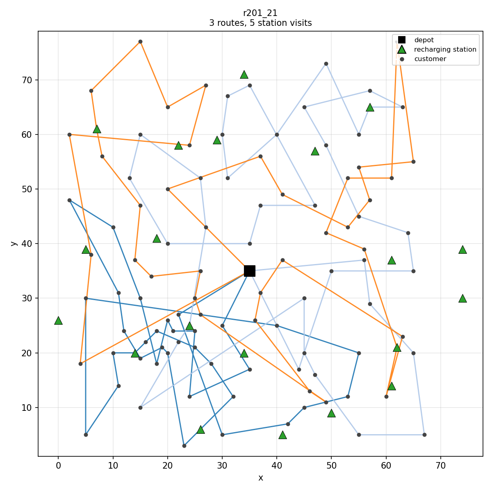
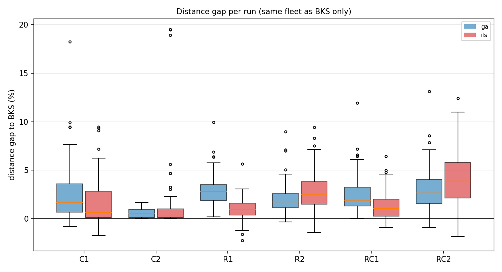
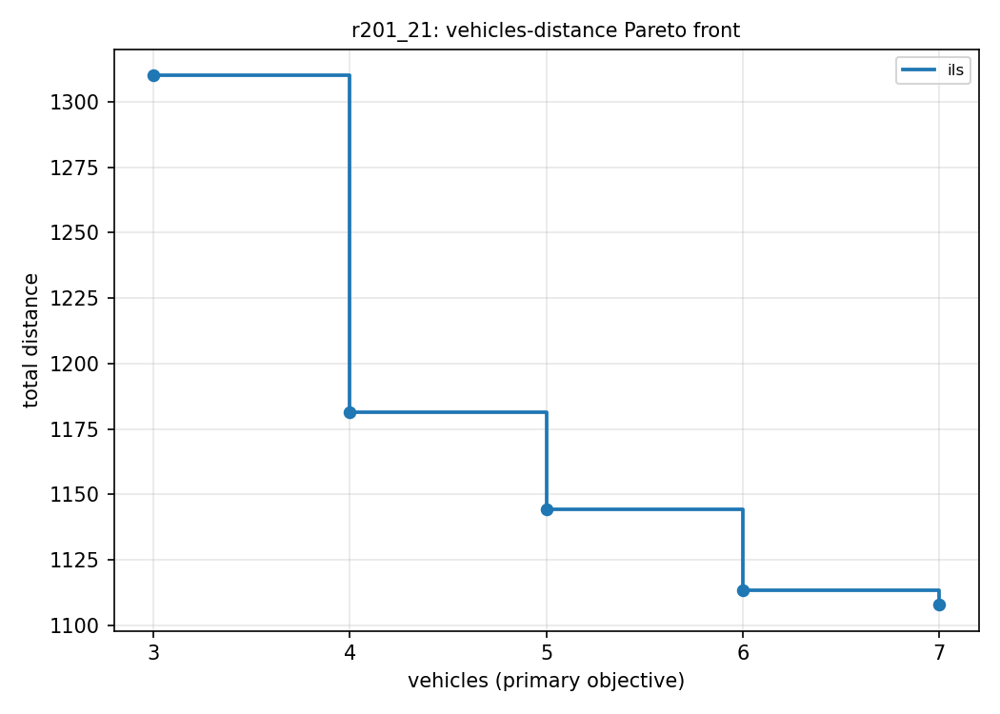
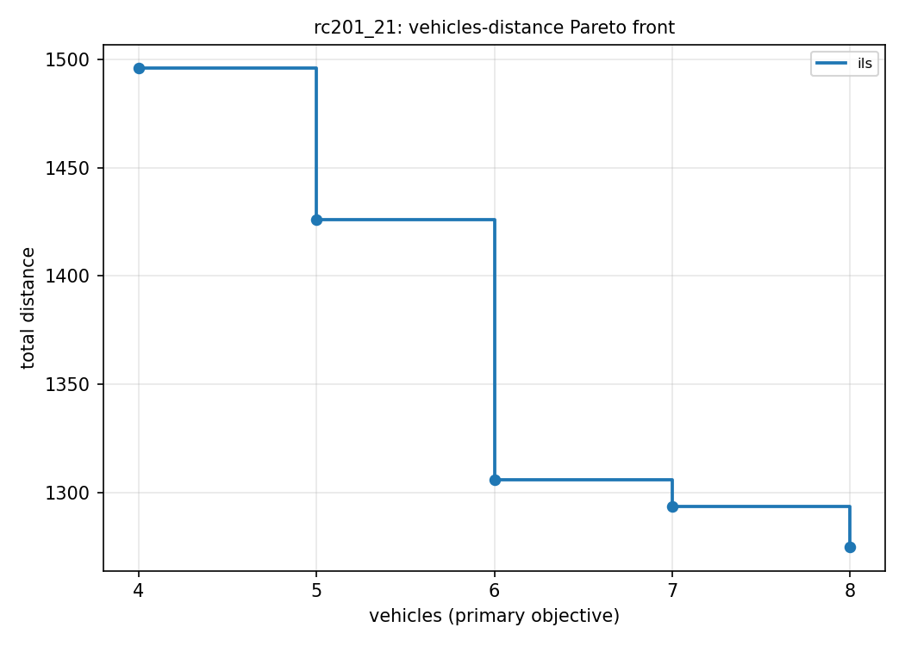

# evrptw-solver

**Electric delivery vans, customer time slots, limited batteries, and chargers.**
This repository plans their routes. It solves small cases exactly with a MILP
(Gurobi) and large ones with two metaheuristics written in modern C++: an Iterated
Local Search and a memetic Genetic Algorithm. Every number below can be reproduced
with one script and was checked by an independent feasibility checker.

<p align="center"></p>

## Results at a glance

On the 92 standard benchmark instances of Schneider, Stenger & Goeke (2014), *Transportation Science*:

| | |
|---|---|
| **Large instances (100 customers, 21 stations)** | The ILS matches the best-known **fleet size on 54 of 56 instances**, at an average distance **+0.17%** from the published best (best of 10 seeds × 30 s on a laptop). |
| **Below the 2014 reference** | On **18 instances** the ILS finds a solution with the same fleet and a **shorter distance** than the values published in 2014, by up to −2.2% on r103. All of them are in [`results/best_solutions/`](results/best_solutions) and pass two independent checkers. |
| **Exact model** | The Gurobi MILP proves optimality on 10 of the 36 small instances within 15 min on a single thread and matches the best-known value on 24. |
| **Bi-objective** | The fleet-vs-distance Pareto fronts show the cost of saving a van. On r201 the minimum of 3 vans costs **+18% distance** compared with 7 vans. |
| **Reliability** | 1,876 runs, **0 infeasible**. Each output is re-simulated by a checker that shares no code with the search. |

> The objective is the benchmark's lexicographic one: **first the number of vehicles, then total distance**. A gap computed on distance alone would compare different problems, so distance gaps are reported only where the fleet equals the best-known fleet.

## The problem in one paragraph

Each van leaves the depot with a full battery, serves customers within their time
windows and respects its load capacity. Driving one unit of distance uses one unit of
energy. When the battery runs low, the van detours to a charging station and recharges
fully, which takes time proportional to the energy missing. Waiting is allowed and
arriving late is not. The goal is to serve every customer with as few vans as
possible and then with the shortest total distance. This is the **E-VRPTW**
(Electric Vehicle Routing Problem with Time Windows and recharging stations), an
NP-hard problem. The hard part is not the routing alone: a cheap move can make the
battery infeasible three stops later, and fixing it with a charger detour can then
break a time window.

## Quick start

```bash
# Linux, CMake >= 3.20, a C++17 compiler. Gurobi is optional.
bash scripts/download_data.sh                      # 92 instances from Mendeley Data (checksum verified)
cmake -S . -B build -DWITH_GUROBI=OFF              # ON (default) if GUROBI_HOME is set
cmake --build build -j
ctest --test-dir build                             # 18 unit tests

./build/evrptw solve data/instances/r101_21.txt --method ils --time 30 --out sol.txt --header
./build/evrptw check data/instances/r101_21.txt sol.txt
./build/evrptw_pareto data/instances/r201_21.txt --time-per-point 20 --extra 4
```

Methods: `greedy`, `ils`, `ga`, and `milp` (requires Gurobi). `solve` prints one CSV
line (`instance,method,seed,time_limit,vehicles,distance,feasible,runtime,lower_bound,optimal`).
It refuses to report a solution that the checker rejects.

## Architecture

```
include/evrptw/            src/
├── Instance.hpp           core/       parser, route simulation, checker, solver factory
├── Solution.hpp           meta/       Constructive, LocalSearch, ILS, GA (+ Split)
├── Checker.hpp            milp/       MilpSolver (Gurobi, compiled only WITH_GUROBI)
├── Solver.hpp             apps/       evrptw (solve/check/info), evrptw_pareto
├── meta/ …  milp/ …       tests/      GoogleTest: core, heuristics, GA, MILP
scripts/   download, experiment runner (parallel, resumable), full campaign
analysis/  gap tables, route / convergence / Pareto / gap plots (Python, matplotlib)
```

The design has five main elements.

- **`Solver` interface + factory.** The MILP, ILS, GA and greedy methods implement
  `solve(Instance, SolverConfig) → SolveResult`, which gives the best solution, a
  convergence trace and, for the MILP, its bounds. The CLI, the Pareto tool and the
  experiment runner all treat the methods the same way.
- **One route simulator, two uses.** `evaluateRoute` *measures* the violations of
  capacity, time (time-warp) and battery instead of rejecting them. The search
  therefore moves through infeasible space with adaptive penalties, which is
  standard in modern VRP heuristics.
- **An independent checker.** `checkSolution` re-simulates strictly and shares no
  code with the search. The CLI refuses to report any result it rejects, and a
  separate Python re-implementation cross-checks the published solutions.
- **Reuse instead of duplication.** The GA reuses the ILS's local search and route
  elimination, and the MILP can take an ILS solution as its MIP start.
- **Optional dependencies.** Gurobi is only needed for the MILP. CI builds and tests
  without a license.

## Methods

**MILP.** The model follows Schneider et al. (2014): station *copies* so that a
charger can be visited more than once, big-M time constraints, battery tracking on
arrival, and a hierarchical objective (vehicles, then distance) through Gurobi
multi-objective. Arcs are pruned using time windows, energy and capacity. With
`--opt warmstart=5` a 5 s ILS run provides the incumbent.

**ILS.** The algorithm starts from a cheapest-insertion construction with greedy
charger repair. Phase A minimises the fleet: it removes the shortest route,
reinserts its customers and searches with rising penalties until the solution is
feasible again. Phase B minimises distance with *ruin & recreate* (10–20% of
customers, random or related) followed by a first-improvement local search. The
local search uses granular neighbourhoods (20 nearest) and cached routes, with the
moves relocate, swap, 2-opt, 2-opt\* and station insertion/removal. Penalties adapt
and acceptance uses a decaying threshold.

**Memetic GA** (in the spirit of HGS, Vidal 2012). Each chromosome is a giant tour
without stations, decoded by Prins' *Split*. Each child is improved by the ILS's
local search. The GA uses OX crossover and survivor selection on biased fitness
(cost rank plus broken-pairs diversity). A plain GA could not reduce the fleet:
children of 18-route parents decoded into 21 or more routes. A short ILS run
therefore fixes the fleet size first, and the GA then works within that cap.

**Pareto front (vehicles vs distance).** The front is built with an ε-constraint on
the fleet: for K = m\*, …, m\*+4, the method minimises *distance only* subject to
at most K vehicles (`--opt objective=distance`). With the lexicographic objective,
each capped run would shrink back to m\* vehicles and the front would collapse to
one point.

## Experimental protocol

| | |
|---|---|
| Instances | 56 large (`*_21`) and 36 small (`*C5`, `*C10`, `*C15`), Schneider et al. (2014) |
| Reference | [`data/bks.csv`](data/bks.csv). Each value is sourced (paper Tables 3–4) and corrections are documented in [`data/BKS_SOURCES.md`](data/BKS_SOURCES.md) |
| Heuristics | ILS and GA, **10 seeds** per instance, fixed wall-clock budget (30 s large, 5 s small) |
| MILP | small instances, 900 s, 3 station copies, 5 s ILS warm start |
| Hardware | Intel i7-1185G7 (laptop), **1 thread per run**, 4 runs in parallel |
| Distances | unrounded Euclidean |

Reproduce everything (≈ 3 h): `bash scripts/run_all.sh`. Then run `analysis/make_tables.py` and the `analysis/plot_*.py` scripts.

## Results

### Large instances (56): best of 10 seeds and mean over runs

| Class | n | ILS fleet = BKS | ILS best gap | ILS mean gap | GA fleet = BKS | GA best gap | GA mean gap |
|---|---|---|---|---|---|---|---|
| C1 | 9 | 9/9 | +0.07% | +1.63% | 9/9 | +0.67% | +2.65% |
| C2 | 8 | 8/8 | +0.00% | +1.51% | 8/8 | +0.15% | +0.54% |
| R1 | 12 | 10/12 | −0.21% | +0.99% | 5/12 | +1.08% | +2.98% |
| R2 | 11 | 11/11 | +0.57% | +2.79% | 11/11 | +0.64% | +2.01% |
| RC1 | 8 | 8/8 | −0.15% | +1.36% | 8/8 | +0.60% | +2.65% |
| RC2 | 8 | 8/8 | +0.69% | +4.08% | 8/8 | +1.98% | +3.06% |
| **All** | **56** | **54/56** | **+0.17%** | **+2.13%** | **49/56** | **+0.82%** | **+2.21%** |

Distance gaps cover only instances (best) or runs (mean) whose fleet equals the BKS
fleet. Full per-instance tables are in [`results/tables/`](results/tables).

<p align="center"></p>

**Reading.** The ILS is the stronger method overall: it reaches the BKS fleet more
often (R1: 10/12 vs 5/12) and has a better best-of-10. The GA is more stable on
clustered and long-horizon classes (C2, R2, RC2 mean gaps). Run-to-run spread is
around 2%, which is why 10 seeds are reported rather than one lucky run.

### Small instances (36): exact vs heuristics

| Size | MILP proven optimal | MILP = BKS | ILS best = BKS fleet | GA best = BKS fleet |
|---|---|---|---|---|
| 5 customers | 7/12 | 9/12 | 12/12 | 12/12 |
| 10 customers | 3/12 | 8/12 | 12/12 | 12/12 |
| 15 customers | 0/12 | 7/12 | 11/12 | 11/12 |

Branch-and-bound on the big-M formulation is the bottleneck: the heuristics find the
best-known solutions in seconds, while the MILP often cannot close the gap in 15 min
(Schneider et al. gave CPLEX 2 h).

### Pareto fronts: what does one fewer van cost?

<p align="center"> </p>

| Instance | Front (vehicles / distance) |
|---|---|
| r201_21 | 3 / 1310 · 4 / 1182 · 5 / 1144 · 6 / 1114 · 7 / 1108 |
| rc201_21 | 4 / 1496 · 5 / 1426 · 6 / 1306 · 7 / 1294 · 8 / 1275 |
| r101_21 | 18 / 1688 · 19 / 1680 · 20 / 1653 |
| c101_21, c201_21 | a single point: the minimum fleet is also the shortest |

On long-horizon instances (R2, RC2), the lexicographic objective hides a large
trade-off: on r201, going from 4 vans down to 3 costs 11% more distance. On clustered instances (C1,
C2) there is no trade-off at all.

## Findings worth knowing

1. **"Optimal" is relative to the formulation.** With 2 copies per station, the MILP
   "proved" rc201C10 optimal at 414.81. The ILS then found 412.86, the published
   value, by visiting the depot charger S0 three times. The model now defaults to 3
   copies and can be configured with `--opt copies=N`.
2. **A typo in the reference table.** Schneider et al. list rc108C5 with 1 vehicle at
   253.93. That distance is only reachable with 2 vehicles: chaining the two routes
   through the depot charger arrives at the depot at t = 388, while its time window
   closes at 240. The correction is documented in `data/BKS_SOURCES.md`.
3. **Below the 2014 values on 18 instances.** The solutions are below the 2014
   values and verified by the C++ checker and by a separate Python re-implementation.
   Later papers have improved several 2014 BKS and this project does not compare
   against them, so these are **not claimed as new records**. The solutions are
   published so that anyone can check them.

## Limitations and next steps

- Move evaluation re-simulates the modified routes in O(route length). With O(1)
  concatenation of forward/backward slack (Vidal et al.), iterations would be
  much faster, especially on long routes (R2/RC2).
- The MILP uses big-M time constraints with a weak LP relaxation. A branch-and-price
  approach (Desaulniers et al. 2016) is the state of the art for exact solving.
- The GA relies on the ILS to set its fleet size. A fleet-aware Split (with a limited
  number of routes) would make it standalone.
- BKS values come from the 2014 paper only, and runtimes are not normalised to the
  original hardware.

---

### Résumé (FR)

Ce projet est un solveur C++17 pour le problème de tournées de véhicules électriques
avec fenêtres de temps et bornes de recharge (E-VRPTW). Il comprend un modèle PLNE
résolu avec Gurobi (exact sur les petites instances), une recherche locale itérée
(ILS) et un algorithme génétique mémétique, organisés autour d'une interface
`Solver` commune. Il calcule aussi un front de Pareto véhicules / distance par
ε-contrainte. Le protocole expérimental porte sur les 92 instances de Schneider et
al. (2014) avec 10 graines par instance et un budget de temps fixe. Les écarts aux
meilleures solutions connues (BKS) sont calculés selon l'objectif lexicographique.
Chaque solution est validée par un vérificateur indépendant.

Résultats : l'ILS retrouve la flotte BKS sur 54 des 56 grandes instances, à +0,17 %
de distance en moyenne. Sur 18 instances, elle passe sous les valeurs publiées en
2014.
